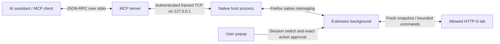

# Architecture

## Components

- `server/index.mjs`: official MCP TypeScript SDK v2; eight named tools and strict Zod argument schemas. Stdout is protocol-only.
- `server/bridge.mjs`: one authenticated native peer; ephemeral listener, process lock, request correlation, bounded queue, deadline and cancellation. An active MCP instance cannot be displaced by another one.
- `server/native-host.mjs`: Firefox launches it using the registered `.cmd` wrapper. Reads the runtime endpoint and forwards length-prefixed JSON messages. It has no page automation logic.
- `server/framing.mjs`: shared bounded native-message framing. Windows uses little-endian 32-bit lengths. This release targets Windows; recheck native byte order and installation conventions when porting.
- `extension/background.js`: session policy, tab scope, current URL checks and user approval. Commands execute serially; grant changes invalidate queued requests from old sessions.
- `extension/content.js`: top-frame page snapshot, ephemeral element references and bounded DOM operations. It is injected only into an authorized tab and refuses stale snapshots/URLs/deadlines.
- `extension/popup.*` and `strings.js`: English, Romanian and Russian UI. Grants/private-window opt-in stay in memory; only language, preferred scope and duration are stored. Broad host permissions are optional and requested inside the enable-switch gesture. Durations use an absolute expiry or null for manual stop; long timers are rearmed within the platform timeout limit.
- `scripts/setup.mjs`: guided Windows setup; optional automatic Codex entry with backup and preservation of unrelated settings. `scripts/build.mjs` produces the prebuilt Windows server with third-party notices.
- `scripts/install.mjs`: per-user Windows registration, native manifest/wrapper, runtime-directory ACL and client configuration examples. Does not modify global assistant settings or launch the browser.

## Tools

| Tool | Behavior | Approval |
| --- | --- | --- |
| `firefox_connection` | Native peer connection state, no page data | No |
| `firefox_request_duration` | Propose minutes from approval time; 0 means manual stop | Explicit popup approval |
| `firefox_tabs` | Eligible tabs in the enabled scope | Session grant |
| `firefox_read` | Visible text, labels and snapshot references | Session grant |
| `firefox_click` | One referenced element | Exact action in popup |
| `firefox_fill` | Replace one ordinary text input/textarea | Exact action and text in popup |
| `firefox_scroll` | At most 2,000 pixels per call | Session grant |
| `firefox_navigate` | Existing tab, HTTP(S), browser mode | Exact destination in popup |

New-tab creation, tab closing, downloads/uploads, cookies, keyboard shortcuts and arbitrary script execution are intentionally not part of v0.1. The client should read again after any action and assess the actual result rather than treating “click dispatched” as task completion.

## Installation and distribution

The extension ID is stable across the manifest and native-host allowed list. The host is registered at `HKCU\Software\Mozilla\NativeMessagingHosts\org.firefox_local_bridge`. The generated manifest points at a local wrapper containing absolute paths; reinstall if the project moves.

Source packaging excludes local registrations, runtime tokens, dependency trees and Git history. An unsigned XPI is a temporary development build, not a signed Firefox release. The compatibility OpenAI plugin manifest is supplied as a scaffold; direct local MCP registration is the development baseline. No API key or model SDK is required by the bridge.

## Porting

The Node/extension logic is largely portable. Linux/macOS need platform-native messaging manifest locations, an executable launcher, appropriate permissions, packaging and manual Firefox testing. Do not advertise those platforms as supported before that work is verified.
